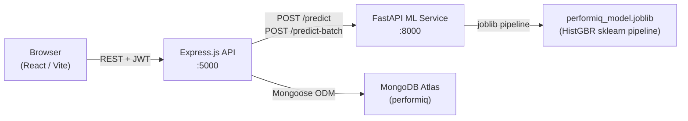

# PerformIQ-AI

> **AI-powered student performance prediction and early-intervention management system.**  
> Built as an academic capstone project demonstrating end-to-end ML integration: data science notebooks → trained model → REST API → React dashboard.

---

## What it does

Many educational institutions identify struggling students too late — only after they have already failed an exam or dropped out.  
**PerformIQ-AI** addresses this by combining two independent ML modules with a live web application:

1. **Module 1 — Exam Score Prediction** uses a HistGradientBoostingRegressor trained on 37 student-lifestyle, academic, and socioeconomic features to predict a student's upcoming exam score (0–100). The prediction drives a risk badge (High / Medium / Low) and a set of rule-based, actionable recommendations.
2. **Module 3 — OULAD Early Warning** applies a gradient-boosted model trained on the Open University Learning Analytics Dataset to flag students who are at risk of withdrawal or failure before the first graded assignment, based on early VLE (Virtual Learning Environment) interaction patterns.

Teachers and administrators use the dashboard to monitor risk levels, record assessments, plan and track interventions, and measure their impact — all in one place.

---

## Architecture



The three services run as independent processes and are connected via environment variables.  
The ML service has no database; it is a stateless inference layer.

---

## Tech stack

| Layer | Technology |
|-------|-----------|
| Frontend | React 18, Vite, Tailwind CSS, React Router v6, Recharts, Axios |
| Backend | Node.js 20, Express 5, Mongoose, JWT, bcrypt, express-rate-limit |
| ML service | Python 3.11, FastAPI, scikit-learn 1.9, pandas 3.0, joblib 1.5, uvicorn |
| Database | MongoDB Atlas (Mongoose schemas) |
| Notebooks | Jupyter, pandas, scikit-learn, matplotlib, seaborn |

---

## Features

- **Risk prediction** — ML-predicted exam score + High / Medium / Low risk badge for every student
- **Actionable recommendations** — Rule-based engine generates up to 5 personalised advice items per prediction
- **Assessment tracking** — Record multiple exam scores per student; interactive line chart on the profile page
- **Intervention management** — Create, update and filter interventions; impact analysis (pre/post score delta)
- **Dashboard analytics** — Risk pie chart, intervention status bar chart, top recommendation reasons aggregated across all students in scope
- **OULAD early warning** — Day-40 / Day-60 / Day-180 ROC-AUC benchmarks and at-risk student cohort (Module 3)
- **Role-aware access** — Admins see everything; teachers see only their own assigned students
- **Batch seeding** — Seed script populates 5000 students, 5000 predictions, ~25k assessments, and ~5000 simulated interventions for realistic demo data

---

## ML Results

### Module 1 — Exam Score Prediction

| Metric | Value |
|--------|-------|
| Algorithm | HistGradientBoostingRegressor (sklearn pipeline) |
| R² (test set) | **0.66** |
| MAE (test set) | **7.3 points** |
| Features | 37 (numerical + categorical with imputation) |
| Missing-value handling | `SimpleImputer` (most-frequent for categorical, median for numerical) |

The model was trained and evaluated on `data/final_student_exam_performance.csv` with an 80/20 train/test split. See `notebooks/` for the full training notebook.

### Module 3 — OULAD Early Warning

| Day cut-off | ROC-AUC |
|-------------|---------|
| Day 40 | **0.81** |
| Day 60 | **0.84** |
| Day 180 | **0.94** |

Trained on the Open University Learning Analytics Dataset (OULAD) using VLE interaction counts up to the specified day. Higher day cut-offs provide more information and therefore better discrimination.

---

## Real vs Simulated data

> [!IMPORTANT]
> The seed script creates simulated records for demo purposes. These are **not real research findings**.

| Data | Source | Flag |
|------|--------|------|
| 5000 students (features) | Sampled from `data/final_student_exam_performance.csv` | `isSeeded: true` |
| ML predictions | Real inference via `/predict-batch` endpoint | `source: "module1"` |
| Assessments | Simulated from `previous_exam_score` ± Gaussian noise | `isSimulated: true` |
| Interventions | Simulated (65% completed, 20% ongoing, 15% planned) | `isSimulated: true` |
| Impact scores | Simulated improvement applied to seeded scores | `isSimulated: true` |

**Warning:** Simulated intervention outcomes do not prove that any intervention is effective. They exist only to populate the dashboard for demonstration purposes.

---

## Known limitations

- The exam-performance dataset has a synthetic structure (all numeric fields capped at round values such as stress = 1–10). Real-world data will differ.
- The model also receives background details (such as gender, family income and location). They are never used to explain a risk or to suggest actions, and in testing they had little effect.
- `device_availability` has a literal string `"None"` in the CSV (meaning no device). The ML service converts this to `null` before inference to match how pandas `read_csv` treated it during training (see `ml-service/main.py#clean_features`).
- Storing the JWT in `localStorage` is convenient but exposes it to XSS attacks. For production, prefer `httpOnly` cookies with CSRF protection.
- The OULAD early-warning module stores aggregated benchmark results in MongoDB; it does not predict individual students from live VLE data in this release.
- Simulated assessments and interventions have fixed random seed (`SEED_RANDOM_SEED`) for reproducibility, not randomness.

---

## Quick-start (5 minutes)

**Prerequisites:** Node.js ≥ 20, Python ≥ 3.11, MongoDB Atlas cluster, Git.

```bash
# 1. Clone
git clone https://github.com/<you>/PerformIQ-AI.git
cd PerformIQ-AI

# 2. Backend
cd backend
cp .env.example .env          # fill in MONGO_URI, MONGO_URI_TEST, JWT_SECRET
npm install
npm run seed                  # creates demo users + 5000 students (takes ~3 min)
node server.js                # API on http://localhost:5000

# 3. ML service (new terminal)
cd ml-service
python -m venv venv
venv\Scripts\activate         # Windows  |  source venv/bin/activate on macOS/Linux
pip install -r requirements.txt
uvicorn main:app --host 127.0.0.1 --port 8000

# 4. Frontend (new terminal)
cd frontend
cp .env.example .env          # or leave defaults for local dev
npm install
npm run dev                   # app on http://localhost:5173
```

**Demo logins** (printed by seed script, also shown on login page):

| Role | Email | Password |
|------|-------|----------|
| Admin | `admin@performiq.ai` | `AdminDemo123!` |
| Teacher 1 | `teacher1@performiq.ai` | `TeacherDemo123!` |
| Teacher 2 | `teacher2@performiq.ai` | `TeacherDemo123!` |
| Teacher 3 | `teacher3@performiq.ai` | `TeacherDemo123!` |

> These are **demo-only** credentials. Change all passwords before any public deployment.

---

## Full setup

### Backend environment variables

See [`backend/.env.example`](backend/.env.example) for a fully documented template. Key variables:

| Variable | Purpose |
|----------|---------|
| `MONGO_URI` | Atlas URI for the production database |
| `MONGO_URI_TEST` | Separate Atlas URI for the test database (never the same as production) |
| `JWT_SECRET` | Long random secret — generate with `node -e "console.log(require('crypto').randomBytes(64).toString('hex'))"` |
| `ML_SERVICE_URL` | Base URL of the FastAPI service (default: `http://localhost:8000`) |
| `NODE_ENV` | Set to `production` in live deployments |
| `AUTH_RATE_LIMIT` | Max login attempts per 15 min per IP (default: 10) |

### Frontend environment variables

| Variable | Purpose |
|----------|---------|
| `VITE_API_URL` | Full base URL of the backend API |
| `VITE_SHOW_DEMO_LOGINS` | Show demo account hints on login page (`true`/`false`) |

### ML service

The FastAPI service takes no `.env` file. All options are CLI flags passed to `uvicorn`. See [`ml-service/.env.example`](ml-service/.env.example).

---

## Running tests

```bash
# Backend (runs both test suites against performiq_test database)
cd backend
npm test

# Expected: 155 tests passing (41 Phase-1 + 114 Phase-2/3)
```

Tests are isolated to the `performiq_test` database (set via `MONGO_URI_TEST`).  
They never read from or write to the production `performiq` database.

---

## API reference

See [`docs/API.md`](docs/API.md) for a full endpoint reference with request/response examples.

A ready-to-import Postman collection is at [`docs/PerformIQ.postman_collection.json`](docs/PerformIQ.postman_collection.json). The Login request automatically saves the token to a collection variable used by all other requests.

---

## Screenshots

> Add screenshots to `docs/screenshots/` — see [`docs/screenshots/SCREENSHOTS.md`](docs/screenshots/SCREENSHOTS.md) for instructions and suggested views:
> - `01-login.png` — Split-screen login with seeded risk distribution & OULAD ROC-AUC benchmark
> - `02-dashboard.png` — Teacher cockpit with "Needs attention today" severity rail & class health bar
> - `03-students-list.png` — Student directory with accessible risk badges & server-side pagination
> - `04-student-profile.png` — Score gauge (50/60 bands), "Why this risk" chips & combined impact timeline
> - `05-add-student.png` — Multi-section student enrollment form
> - `06-interventions.png` — Status-filtered intervention directory & impact evaluation modal
> - `07-early-warning.png` — OULAD temporal ROC-AUC cutoff chart & telemetry

<!-- Uncomment after adding screenshots:


-->

---

## Production deployment checklist

> [!CAUTION]
> Do NOT deploy with any of the default values listed below.

| Setting | Required action |
|---------|----------------|
| `JWT_SECRET` | Replace with ≥ 64 random bytes |
| `DEMO_ADMIN_PASSWORD` | Change to a strong unique password or remove the demo account |
| `DEMO_TEACHER_PASSWORD` | Change to strong unique passwords or remove the demo accounts |
| `NODE_ENV` | Set to `production` |
| `CORS_ORIGIN` | Set to your exact frontend domain (not `*`) |
| `AUTH_RATE_LIMIT` | Keep at 10 (or lower) — do NOT raise in production |
| `VITE_SHOW_DEMO_LOGINS` | Set to `false` |
| ML service host | Bind to `127.0.0.1` only; do NOT expose port 8000 publicly |
| Morgan logging | Automatically switches to `combined` format when `NODE_ENV=production` |
| Error messages | 500 errors return a generic message in production (stack traces are suppressed) |

The backend startup check (`server.js`) will `process.exit(1)` if `NODE_ENV=production` is set alongside a default JWT secret or demo password.

---

## Credits

- **Exam performance dataset** — *Student Exam Performance Prediction* dataset, Kaggle.  
  Used for Module 1 model training. Synthetic/educational dataset.

- **OULAD** — Kuzilek J., Hlosta M., Zdrahal Z. (2017). *Open University Learning Analytics dataset*. Scientific Data 4, 170171. [https://doi.org/10.1038/sdata.2017.171](https://doi.org/10.1038/sdata.2017.171)  
  Licensed under [Creative Commons Attribution 4.0 International (CC BY 4.0)](https://creativecommons.org/licenses/by/4.0/).  
  Used for Module 3 (OULAD early-warning).

---

## Licence

[MIT](LICENSE) © 2026 Chakshita
